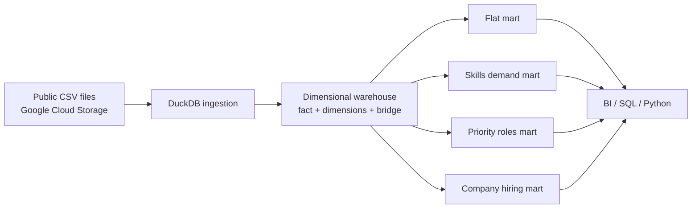
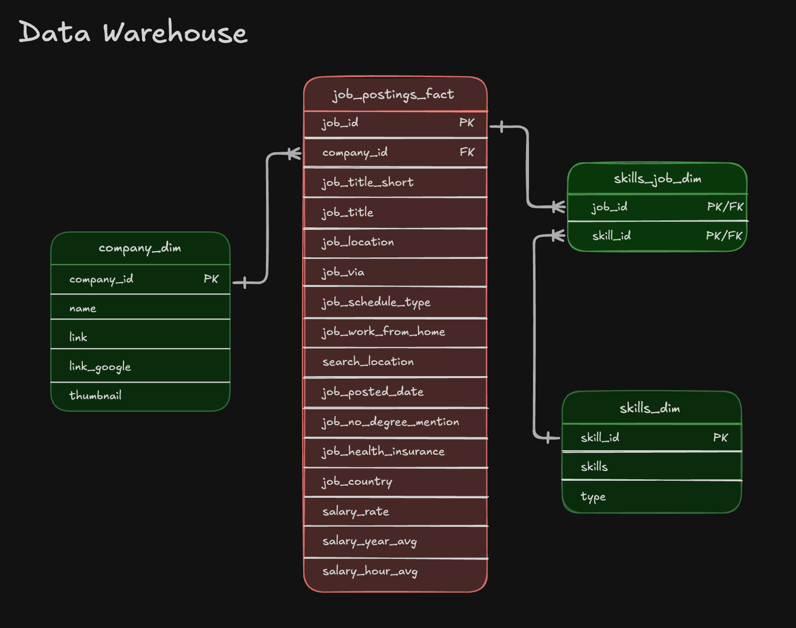
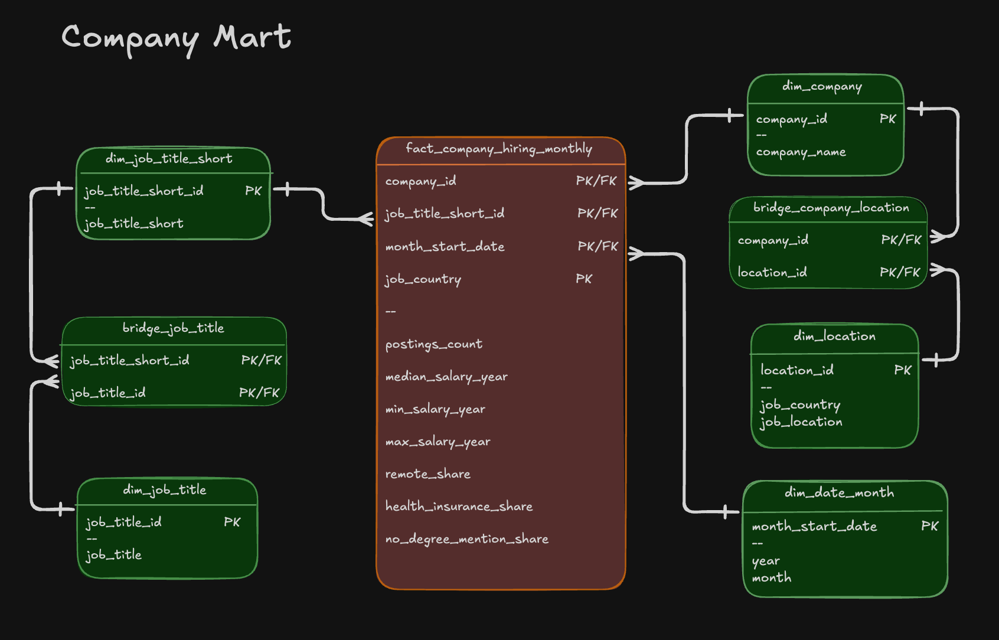

<div align="center">

# SQL Data Warehouse & Analytical Marts

**An end-to-end SQL data engineering project that transforms public job-posting CSVs into a dimensional warehouse and four analytics-ready data marts.**


</div>

<p align="center">
  
</p>

> **Runtime note:** The diagram presents MotherDuck as an optional cloud-serving target. The repository itself runs locally with the DuckDB CLI and does not require a MotherDuck account.

## Executive Summary

This portfolio project demonstrates how a data engineer can take denormalized source files and create governed, reusable analytical models with SQL.

- **Warehouse design:** Models job postings as a fact table with company and skill dimensions plus a many-to-many skill bridge.
- **ETL development:** Loads public CSV data directly from Google Cloud Storage and applies explicit column mapping and data types.
- **Mart engineering:** Builds flat, skills-demand, priority-role, and company-hiring marts for different analytical workloads.
- **Incremental processing:** Uses `MERGE` to synchronize a priority-jobs snapshot with insert, update, and delete behavior.
- **Quality controls:** Runs key-integrity, non-empty-output, and valid-range checks after the build.
- **Reproducibility:** Provides a one-command build and a fast, network-free smoke test for every transformation script.

## Business Problem

Raw job-posting CSVs are useful for storage and exchange, but they are inefficient for repeatable analytics. Analysts need trusted models that answer questions such as:

- Which technical skills are gaining demand over time?
- Which companies and locations are hiring for specific roles?
- How do salary patterns vary by company, role, and geography?
- Which priority roles have new, changed, or removed postings?

The solution separates reusable warehouse entities from purpose-built marts so BI and analytics consumers can query the appropriate grain without rebuilding complex joins.

## Architecture



| Layer | Main objects | Purpose |
|---|---|---|
| Source | Four public CSV files in Google Cloud Storage | Raw company, skill, posting, and job-skill data |
| Warehouse | `company_dim`, `skills_dim`, `job_postings_fact`, `skills_job_dim` | Conformed analytical source of truth |
| Flat mart | `flat_mart.job_postings` | Wide model for rapid exploration |
| Skills mart | Monthly skill dimensions and fact table | Time-series demand analysis |
| Priority mart | Role rules and synchronized job snapshot | Incremental priority-role monitoring |
| Company mart | Dimensions, bridges, and monthly hiring fact | Company, role, country, and salary analysis |

## Data Models

### Core Warehouse

The warehouse uses one row per job posting in `job_postings_fact`. `skills_job_dim` resolves the many-to-many relationship between job postings and skills.

<p align="center">
  
</p>

### Flat Mart

`flat_mart.job_postings` keeps one row per posting and packages skill names and types into a nested array. This reduces join complexity for exploratory SQL and downstream extracts.

<p align="center">
  
</p>

### Skills Demand Mart

`skills_mart.fact_skill_demand_monthly` has the grain `skill_id + month_start_date + job_title_short`. Its count measures are additive and safe to aggregate across skills, roles, and time.

<p align="center">
  
</p>

### Priority Roles Mart

The priority mart stores configurable role levels and a current posting snapshot. The update script changes role rules, stages the current source state, and applies a single `MERGE` for matched, new, and removed records.

<p align="center">
  
</p>

### Company Hiring Mart

`company_mart.fact_company_hiring_monthly` has the grain `company_id + job_title_short_id + job_country + month_start_date`. It includes posting counts, salary statistics, and ratio measures for remote work, health insurance, and degree requirements.

<p align="center">
  
</p>

## Pipeline Sequence

| Step | Script | Responsibility |
|---:|---|---|
| 1 | [`01_create_tables_dw.sql`](01_create_tables_dw.sql) | Recreates the core warehouse tables, keys, and relationships |
| 2 | [`02_load_schema_dw.sql`](02_load_schema_dw.sql) | Clears and reloads warehouse data from public GCS CSVs |
| 3 | [`03_create_flat_mart.sql`](03_create_flat_mart.sql) | Builds the denormalized posting-level model |
| 4 | [`04_create_skills_mart.sql`](04_create_skills_mart.sql) | Builds monthly skill-demand dimensions and facts |
| 5 | [`05_create_priority_mart.sql`](05_create_priority_mart.sql) | Creates priority rules and the initial snapshot |
| 6 | [`06_update_priority_mart.sql`](06_update_priority_mart.sql) | Applies incremental snapshot changes with `MERGE` |
| 7 | [`07_create_company_mart.sql`](07_create_company_mart.sql) | Builds company, title, location, date, bridge, and fact models |
| 8 | [`08_validate_pipeline.sql`](08_validate_pipeline.sql) | Fails the build when critical quality checks do not pass |

[`build_dw_marts.sql`](build_dw_marts.sql) orchestrates all eight steps in dependency order.

## Quick Start

### Prerequisites

- [DuckDB CLI](https://duckdb.org/docs/stable/clients/cli/overview.html)
- Internet access for the full build because source CSVs are read from Google Cloud Storage

### Build the Complete Warehouse and Marts

Run from the repository root:

```powershell
duckdb dw_marts.duckdb -c ".read build_dw_marts.sql"
```

The database file is generated locally and intentionally excluded from Git because it is a reproducible build artifact.

### Run the Fast Smoke Test

The smoke test uses a small in-memory fixture, requires no network access, exercises every mart script, and runs the same validation checks as the full pipeline.

```powershell
duckdb :memory: -c ".read tests/smoke_test.sql"
```

### Query an Output

```powershell
duckdb dw_marts.duckdb -c "
SELECT
    skill.skills,
    SUM(demand.postings_count) AS postings
FROM skills_mart.fact_skill_demand_monthly AS demand
JOIN skills_mart.dim_skills AS skill
    ON demand.skill_id = skill.skill_id
GROUP BY skill.skills
ORDER BY postings DESC
LIMIT 10;"
```

## Validation Strategy

The final pipeline step stops execution when a critical rule fails. Current checks confirm that:

- The warehouse fact table contains data.
- Company foreign keys resolve to `company_dim`.
- Skill bridge keys resolve to both their skill and job records.
- Every analytical mart contains data.
- Company-mart ratio measures remain between `0` and `1`.

Primary keys, foreign keys, explicit target columns, deterministic surrogate-key generation, and full schema rebuilds provide additional safeguards.

## SQL Engineering Highlights

- **Dimensional modeling:** Fact, dimension, bridge, and aggregate fact tables at documented grains.
- **Incremental loading:** `MERGE` with `WHEN MATCHED`, `WHEN NOT MATCHED`, and `WHEN NOT MATCHED BY SOURCE` branches.
- **Analytical SQL:** CTEs, window functions, nested structs, array aggregation, date truncation, conditional aggregation, and median calculations.
- **Idempotency:** The master build recreates schemas and reloads source tables so repeated runs produce a clean state.
- **Maintainability:** Numbered scripts, explicit column lists, logical schemas, orchestration, and separate validation.
- **Performance orientation:** Pre-aggregated marts reduce repeated joins and calculations for common analytical queries.

## Repository Structure

```text
sql-data-warehouse-mart-pipeline/
|-- docs/
|   `-- images/                    # Architecture and schema diagrams
|-- tests/
|   `-- smoke_test.sql             # Network-free end-to-end SQL test
|-- 01_create_tables_dw.sql        # Core warehouse DDL
|-- 02_load_schema_dw.sql          # GCS CSV ingestion
|-- 03_create_flat_mart.sql        # Posting-level flat mart
|-- 04_create_skills_mart.sql      # Monthly skills demand mart
|-- 05_create_priority_mart.sql    # Initial priority snapshot
|-- 06_update_priority_mart.sql    # Incremental MERGE update
|-- 07_create_company_mart.sql     # Company hiring dimensional mart
|-- 08_validate_pipeline.sql       # Data quality assertions
|-- build_dw_marts.sql             # Master build entry point
|-- .gitignore                     # Excludes generated databases
`-- README.md
```

## Scope and Trade-offs

- The source bucket is public and managed outside this repository; full builds depend on its availability.
- The project focuses on SQL transformation and modeling, so scheduling, secrets management, and BI dashboards are outside the current scope.
- The included architecture image shows MotherDuck as an optional serving path; the implemented runtime is local DuckDB.
- The generated `dw_marts.duckdb` file is not versioned. Rebuild it from the SQL source to keep the repository lightweight and reviewable.

## Author

Built by [Masthan Shaik](https://github.com/masthan-shaik-cse) as a data engineering portfolio project focused on SQL ETL, dimensional modeling, analytical marts, and reliable incremental processing.
